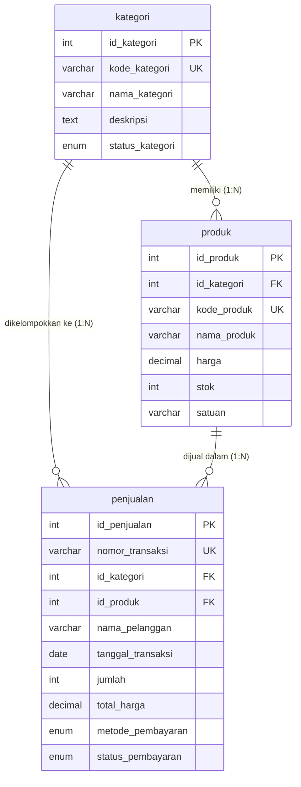

# Penugasan Web & Basis Data: Sistem Toko Online

Dokumentasi resmi aplikasi web sederhana berbasis PHP Native dan database MariaDB/MySQL untuk penugasan praktikum/kuliah.

---

## 📌 Identitas Mahasiswa & Proyek

- **NPM**: `26081010039`
- **Nama**: `Niam`
- **Nama Proyek**: `Toko Online`
- **Format Folder**: `26081010039_Niam_TokoOnline`
- **Nama Database**: `db_tokoonline_26081010039`

---

## 📂 Struktur Direktori Proyek

Struktur folder disusun sesuai dengan spesifikasi modul penugasan:

```text
26081010039_Niam_TokoOnline/
├── database/
│   └── schema.sql        # Skrip DDL (CREATE TABLE + FK), DML (INSERT data), & Query Sample
├── services/
│   └── config.php        # Konfigurasi & koneksi database menggunakan mysqli
├── css/
│   └── style.css         # Salinan styling pendukung (opsional)
├── index.php             # Halaman utama untuk mengambil & menampilkan 3 tabel secara dinamis
├── style.css             # Styling CSS utama (Warna brand, Flexbox, Grid, Box Model, Responsif)
└── README.md             # Dokumentasi proyek, relasi basis data, & panduan penggunaan
```

---

## 🗄️ Penjelasan Rancangan Basis Data

Sistem menggunakan 3 tabel relasional yang saling terhubung: 2 tabel master (`kategori` dan `produk`) serta 1 tabel transaksi (`penjualan`).

### 1. Entitas dan Atribut

#### A. Entitas `kategori` (Tabel Master 1)

Menyimpan pengelompokan produk barang dagangan.

| Nama Kolom        | Tipe Data                 | Keterangan                             | Atribut Khusus              |
| :---------------- | :------------------------ | :------------------------------------- | :-------------------------- |
| `id_kategori`     | INT                       | Identifier unik kategori               | PRIMARY KEY, AUTO_INCREMENT |
| `kode_kategori`   | VARCHAR(20)               | Kode unik kategori (misal: `KAT-ELEC`) | NOT NULL, UNIQUE            |
| `nama_kategori`   | VARCHAR(100)              | Nama jenis/kategori barang             | NOT NULL                    |
| `deskripsi`       | TEXT                      | Deskripsi lengkap kategori barang      | NULL                        |
| `status_kategori` | ENUM('Aktif', 'Nonaktif') | Status ketersediaan kategori           | NOT NULL, DEFAULT 'Aktif'   |

#### B. Entitas `produk` (Tabel Master 2)

Menyimpan katalog item produk yang dijual di toko online.

| Nama Kolom    | Tipe Data      | Keterangan                                  | Atribut Khusus                         |
| :------------ | :------------- | :------------------------------------------ | :------------------------------------- |
| `id_produk`   | INT            | Identifier unik produk                      | PRIMARY KEY, AUTO_INCREMENT            |
| `id_kategori` | INT            | ID Kategori induk barang                    | FOREIGN KEY -> `kategori(id_kategori)` |
| `kode_produk` | VARCHAR(20)    | Kode SKU unik barang (misal: `PRD-ELC-001`) | NOT NULL, UNIQUE                       |
| `nama_produk` | VARCHAR(150)   | Nama lengkap produk                         | NOT NULL                               |
| `harga`       | DECIMAL(12, 2) | Harga jual satuan (Rupiah)                  | NOT NULL                               |
| `stok`        | INT            | Jumlah ketersediaan stok fisik              | NOT NULL, DEFAULT 0                    |
| `satuan`      | VARCHAR(20)    | Satuan kuantitas (Pcs, Unit, Pack, Buku)    | NOT NULL, DEFAULT 'Pcs'                |

#### C. Entitas `penjualan` (Tabel Transaksi / Relasi 3)

Menyimpan pencatatan riwayat transaksi penjualan yang menghubungkan data kategori dan produk.

| Nama Kolom          | Tipe Data      | Keterangan                                                | Atribut Khusus                         |
| :------------------ | :------------- | :-------------------------------------------------------- | :------------------------------------- |
| `id_penjualan`      | INT            | Identifier unik transaksi                                 | PRIMARY KEY, AUTO_INCREMENT            |
| `nomor_transaksi`   | VARCHAR(30)    | Nomor referensi nota (misal: `TRX-20261001-001`)          | NOT NULL, UNIQUE                       |
| `id_kategori`       | INT            | Referensi kategori barang yang dibeli                     | FOREIGN KEY -> `kategori(id_kategori)` |
| `id_produk`         | INT            | Referensi produk barang yang dibeli                       | FOREIGN KEY -> `produk(id_produk)`     |
| `nama_pelanggan`    | VARCHAR(100)   | Nama pembeli/konsumen                                     | NOT NULL                               |
| `tanggal_transaksi` | DATE           | Tanggal terjadinya transaksi                              | NOT NULL                               |
| `jumlah`            | INT            | Jumlah kuantitas barang yang dibeli                       | NOT NULL                               |
| `total_harga`       | DECIMAL(12, 2) | Total nilai transaksi (Rupiah)                            | NOT NULL                               |
| `metode_pembayaran` | ENUM(...)      | Metode bayar (Transfer Bank, E-Wallet, Kartu Kredit, COD) | NOT NULL                               |
| `status_pembayaran` | ENUM(...)      | Status bayar (Lunas, Menunggu Pembayaran, Dibatalkan)     | NOT NULL, DEFAULT 'Lunas'              |

---

### 2. Relasi dan Kardinalitas

1. **Relasi `kategori` ke `produk` (One-to-Many / 1:N)**
   - **Kardinalitas**: **1 to Many** (Satu kategori dapat memiliki banyak item produk).
   - **Keterangan**: Kolom `id_kategori` pada tabel `produk` merupakan Foreign Key yang mereferensikan `id_kategori` pada tabel `kategori`.
2. **Relasi `produk` ke `penjualan` (One-to-Many / 1:N)**
   - **Kardinalitas**: **1 to Many** (Satu produk dapat tercatat di dalam banyak transaksi penjualan).
   - **Keterangan**: Kolom `id_produk` pada tabel `penjualan` merupakan Foreign Key yang mereferensikan `id_produk` pada tabel `produk`.

3. **Relasi `kategori` ke `penjualan` (One-to-Many / 1:N)**
   - **Kardinalitas**: **1 to Many** (Satu kategori dapat tercatat di dalam banyak transaksi penjualan).
   - **Keterangan**: Kolom `id_kategori` pada tabel `penjualan` merupakan Foreign Key yang mereferensikan `id_kategori` pada tabel `kategori`.



---

## 💻 Sample Query SQL (DDL, DML, & Query Pelaporan)

Berikut adalah contoh kueri dasar sesuai dengan kriteria penugasan:

### 1. Sample SELECT (Filter & Pengurutan)

Mengambil data produk yang memiliki stok di atas 20 unit diurutkan dari harga termahal:

```sql
SELECT id_produk, kode_produk, nama_produk, harga, stok, satuan
FROM produk
WHERE stok > 20
ORDER BY harga DESC;
```

### 2. Sample JOIN (Relasi Multi-Tabel)

Menggabungkan data transaksi dari tabel `penjualan` dengan data nama produk dari tabel `produk` dan nama kategori dari tabel `kategori`:

```sql
SELECT
    pj.nomor_transaksi,
    pj.tanggal_transaksi,
    pj.nama_pelanggan,
    k.nama_kategori,
    p.nama_produk,
    p.harga AS harga_satuan,
    pj.jumlah,
    pj.total_harga,
    pj.metode_pembayaran,
    pj.status_pembayaran
FROM penjualan pj
INNER JOIN produk p ON pj.id_produk = p.id_produk
INNER JOIN kategori k ON pj.id_kategori = k.id_kategori
ORDER BY pj.tanggal_transaksi DESC;
```

### 3. Sample UPDATE

Memperbarui jumlah stok dan harga pada produk tertentu:

```sql
UPDATE produk
SET stok = stok - 2, harga = 499000.00
WHERE id_produk = 1;
```

### 4. Sample DELETE

Menghapus riwayat transaksi penjualan yang dibatalkan:

```sql
DELETE FROM penjualan
WHERE status_pembayaran = 'Dibatalkan';
```

---

## 🚀 Panduan Menjalankan Proyek

### Prasyarat

1. Web server lokal (PHP versi 7.4 ke atas atau PHP 8.x).
2. Database server (MySQL atau MariaDB).
3. Ekstensi `mysqli` aktif di PHP.

---

### Langkah 1: Persiapan Database

1. Buka terminal atau konsol MySQL/MariaDB:
   ```bash
   mariadb -u root -p
   ```
2. Import skrip schema yang sudah disediakan:
   ```bash
   mariadb -u root -p < database/schema.sql
   ```
   _Atau jika menggunakan **phpMyAdmin**: Buka menu **Import**, pilih file `database/schema.sql`, lalu klik tombol **Go/Kirim**._

---

### Langkah 2: Konfigurasi Koneksi (`services/config.php`)

Periksa pengaturan database di file [services/config.php](file:///home/linuxniam/Projects/Php/26081010039_Niam_TokoOnline/services/config.php):

```php
$host     = "127.0.0.1";
$user     = "root";
$password = "root"; // Sesuaikan dengan password database lokal Anda (kosongkan jika pakai XAMPP default)
$database = "db_tokoonline_26081010039";
$port     = 3306;
```

> **Catatan**: Script `services/config.php` telah dilengkapi fitur _auto-fallback_, sehingga jika password `'root'` gagal, script akan otomatis mencoba koneksi tanpa password (standar bawaan XAMPP di Windows).

---

### Langkah 3: Menjalankan Web Server Lokal

Jalankan server bawaan PHP langsung dari dalam direktori folder proyek:

```bash
cd /home/linuxniam/Projects/Php/26081010039_Niam_TokoOnline
php -S localhost:8000
```

---

### Langkah 4: Membuka Aplikasi di Browser

Buka peramban (browser) dan akses URL:

```text
http://localhost:8000
```

Seluruh 3 tabel (Kategori, Produk, Penjualan) beserta ringkasan statistik akan langsung tampil secara dinamis dari database.
